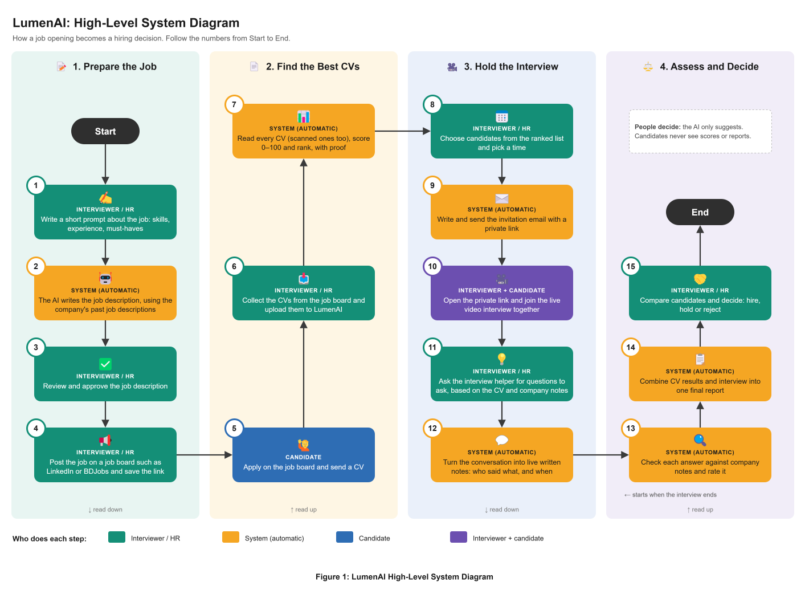

<h1 align="center">LumenAI</h1>

<p align="center">
  <b>AI recruitment and interview intelligence.</b><br>
  From a short prompt to an evidence-backed hiring decision.
</p>

<p align="center">
  
  
  
  
  
  
</p>

---

## Table of contents

1. [About the project](#about-the-project)
2. [Features](#features)
3. [How it works](#how-it-works)
4. [Architecture](#architecture)
5. [Technology stack](#technology-stack)
6. [Repository structure](#repository-structure)
7. [Getting started](#getting-started)
8. [Configuration](#configuration)
9. [Usage walkthrough](#usage-walkthrough)
10. [API reference](#api-reference)
11. [AI workflows](#ai-workflows)
12. [Privacy and security](#privacy-and-security)
13. [Troubleshooting](#troubleshooting)
14. [Known limitations](#known-limitations)
15. [Branching and commits](#branching-and-commits)
16. [Documentation](#documentation)
17. [Author](#author)

---

## About the project

Recruitment teams receive more applications than they can assess consistently. Screening is done under time pressure, criteria drift between reviewers, and interview outcomes end up as loose notes that are hard to compare or defend.

LumenAI supports the recruiter through the whole hiring flow, from writing the job description to the final decision. At every step the AI shows the evidence behind its suggestion, and a person makes the decision.

**Positioning:** AI recruitment and interview intelligence, from a short prompt to an evidence-backed hiring decision.

**Why the name "LumenAI":** _to be written by the author (two to four sentences)._

**Three principles apply throughout the system:**

| Principle | How it is enforced |
|---|---|
| **The AI suggests, code checks** | Quotes, sources, requirement names and scores are verified or calculated by code, never trusted as returned by the AI. |
| **A person decides** | The AI never approves a job, posts it, or makes a hiring decision. Those actions need an interviewer's explicit confirmation. |
| **Only job-relevant evidence** | Voice, appearance, confidence and personal characteristics are never assessed. Candidates never see scores or reports. |

## Features

### Core

| # | Feature | Summary |
|---|---|---|
| F1 | Job preparation, CV collection, screening and ranking | An assistant chat writes the job description from a short prompt, using the company's own documents (RAG). After approval, the job is posted to Blogger through an MCP tool. Applications arrive through a Google Form; each CV is read (OCR for scanned files), checked against every requirement with a quote as proof, and ranked. |
| F2 | Candidate scoring | Skills, experience and qualifications are rated and combined into a weighted CV score, using weights set per job. |
| F3 | Video interview | Shortlist, scheduling, an AI-written invitation with a calendar invite and a private join link, and a live video call (LiveKit) with chat and screen sharing. An **AI Helper** suggests questions with model answers and answers the interviewer's questions during the call. |
| F4 | Live transcript | Each participant's microphone is transcribed live (Deepgram) with the speaker and the time of every sentence. |
| F5 | Interview answer analysis | Each question and answer is found in the transcript and graded on relevance, accuracy, completeness and articulation, with a verified quote, the company document used, and a suggested follow-up question. Answers are mapped to job requirements. |
| F6 | Consolidated assessment | One final report per candidate: CV score, interview score and overall score, strengths and weaknesses with quotes, evidence gaps and areas to explore. Includes a ranked comparison of candidates, the hiring decision, and PDF / HTML export. |

### Stretch

_None attempted yet._

### Innovation (F11)

| Feature | What it does |
|---|---|
| Talent pool and rediscovery | The interviewer keeps strong past candidates from their assessment report. When a new job is approved, code finds pool candidates whose CV shows its skills (match %; required skills count twice; other names of a skill count the same). The interviewer filters the list (minimum match, all required skills, earlier score, status, already invited). A LangGraph workflow drafts and checks a personal invitation; the interviewer edits it or writes it again with a wish, then sends it. The match uses only job skills and CV text, and counterfactual tests prove that name, gender, age, nationality and address do not change it. Every email has an apply link and an unsubscribe link; entries expire after `POOL_KEEP_DAYS`. |

## How it works

```
 JD  →  Job post  →  CV collection  →  Screening  →  Selection  →  Interview  →  Analysis  →  Final report
 │        │             │                 │             │             │             │             │
 Assistant Blogger       Google Form +     AI reads      Shortlist,    LiveKit call, Q&A grading   Assessment,
 chat +    (MCP, after   Drive (service    each CV,      schedule,     live          on 4         comparison,
 RAG       a person's    account)          checks every  AI-written    transcript,   criteria,    decision,
           Yes)                            requirement   invitation    AI Helper     requirements PDF / HTML
```

1. **Prepare the job.** The interviewer describes the role in the Assistant chat. The AI drafts the job profile from the company's documents; the interviewer edits and approves it, and the job is posted after an explicit confirmation.
2. **Collect and screen CVs.** Applications are read from the job's Google Form. Each CV is screened in the background: requirement matches with quotes, section scores, an overall CV score and a ranking. The interviewer can include or exclude any candidate.
3. **Interview.** Shortlisted candidates receive an invitation with a private link. During the call, the transcript is written live and the AI Helper suggests questions.
4. **Analyse.** After the call, the answers are graded and mapped to the job requirements.
5. **Decide.** The final assessment combines the CV and the interview into one report. The interviewer compares candidates and records hire, hold or reject.

## Architecture

### High-level system diagram

The steps of the hiring flow and who carries out each one.



### Detailed architecture

Each step with the page, backend service, workflow, outside service and database table that carry it out.


### LangGraph design

The multi-step AI work runs as LangGraph workflows with parallel branches, retries and repair loops. Single AI calls (for example the AI Helper) are plain functions.


The diagrams generated directly from the code are in [`docs/architecture/LumenAI_Workflows_From_Code.md`](docs/architecture/LumenAI_Workflows_From_Code.md) (see [AI workflows](#ai-workflows)).

### Request flow inside the backend

Every feature follows the same layers:

```
React page (.jsx) → API client (.js) → Router (validates the request) → Service (business rules)
                                                                      → LangGraph workflow (AI steps) → PostgreSQL
```

Long-running AI work (screening, Q&A analysis, assessment) answers `202 Accepted` at once and runs in the background; the page polls for the result. Unfinished work resumes automatically after a restart.

## Technology stack

| Layer | Choice | Why |
|---|---|---|
| Frontend | React 19 + Vite | Fast to build screens; widely known. |
| Backend | FastAPI + SQLModel | Required stack; typed endpoints with automatic API docs. |
| Database | PostgreSQL 16 + Alembic | Reliable relational store; versioned schema migrations. |
| AI workflows | LangGraph | Required stack; makes each AI step, branch, retry and pause explicit. |
| AI model | Google Gemini | Text, vision (scanned CVs) and embeddings from one provider. |
| Tool protocol | MCP (FastMCP) | Lets the assistant chat choose tools; posting stays behind a person's confirmation. |
| Video call | LiveKit Cloud | Hosted video rooms; works for candidates on any network. |
| Speech-to-text | Deepgram | Live streaming transcription over WebSocket. |
| CV collection | Google Forms + Drive API | Candidates apply through a form; CVs are read with a service account. |
| Job posting | Blogger API | Public job posts with an "Apply now" link. |
| Email | SMTP (e.g. Gmail) | Invitations with a calendar invite. |
| Packaging | Docker Compose | One command starts the whole application. |

## Repository structure

```
.
├── backend/
│   ├── app/
│   │   ├── main.py            FastAPI app: routers, start-up, resume of unfinished work
│   │   ├── core/              settings, database, security, list of all tables
│   │   ├── ai/                llm_client (the only place that calls the AI) and the offline fake AI
│   │   ├── graphs/            LangGraph workflows and their prompts
│   │   ├── mcp_servers/       MCP servers (Blogger, recruitment tools) and the MCP client
│   │   ├── utils/             shared helpers
│   │   └── features/          one folder per feature: models/ schemas/ services/ routers/
│   ├── migrations/            Alembic database migrations
│   ├── scripts/               blogger_login.py, print_workflows.py
│   ├── tests/                 automated tests
│   └── requirements.txt
├── frontend/
│   └── src/
│       ├── main.jsx           chooses the page by address (app, candidate page, call, analysis, report)
│       ├── App.jsx            sidebar layout and pages
│       ├── shared/            HTTP client, login token, styles, shared components
│       └── features/          one folder per feature
├── docs/architecture/         diagrams (.svg and .drawio) and workflows generated from the code
├── docker-compose.yml
├── .env.example
└── README.md
```

| Feature folder | Purpose |
|---|---|
| `auth` | Interviewer accounts and login |
| `system` | Connection checks and the workflow run log |
| `assistant` | Assistant chat: the AI chooses tools; a person confirms approval and posting |
| `job_library` | Company documents used for RAG (job descriptions and policy notes) |
| `jobs` | Job profiles, approval and Blogger posts |
| `candidates` | Applications from the Google Form, CV files and uploads |
| `screening` | CV screening, scores, ranking, the interviewer's include / exclude decision and the shortlist |
| `interviews` | Scheduling, invitation email, video call, call chat, candidate profile |
| `interview_helper` | AI Helper during the call: suggested questions and chat |
| `transcripts` | Live speech-to-text and the saved transcript |
| `qa_analysis` | Grading of each interview answer (F5) |
| `assessments` | Final report, decision and candidate comparison (F6) |
| `talent_pool` | Talent pool, matching for new jobs, invitations and the unsubscribe link (F11) |

## Getting started

### Prerequisites

| Tool | Version | Needed for |
|---|---|---|
| Docker Desktop (with Compose) | recent | running the full application |
| Git | any | cloning the repository |
| Python | 3.11 | local backend development and tests (optional with Docker) |
| Node.js | 22 | local frontend development (optional with Docker) |

API keys are needed for the outside services; see [Configuration](#configuration). Without keys, the app can run with the offline fake providers (`LLM_PROVIDER=fake`, `STT_PROVIDER=fake`, `DRIVE_PROVIDER=fake`, `BLOGGER_PROVIDER=fake`).

### Option A: run everything with Docker (recommended)

1. **Clone the repository and choose the branch**
   ```bash
   git clone <repository-url>
   cd lumenAi
   git checkout <branch>        # the latest module branch, e.g. m5
   ```
2. **Create the configuration file**
   ```bash
   cp .env.example .env          # Windows: copy .env.example .env
   ```
   Fill in at least `SECRET_KEY` and `LLM_API_KEY` (or set `LLM_PROVIDER=fake`). See [Configuration](#configuration).
3. **Add secret files (only if used)**
   Place the Google service-account key at `secrets/google-drive.json`. The `secrets/` folder is never committed.
4. **Build and start**
   ```bash
   docker compose up --build
   ```
5. **Open the application**

   | Address | What |
   |---|---|
   | http://localhost:8090 | the web app (`WEB_PORT`) |
   | http://localhost:8010/docs | interactive API documentation (`API_PORT`) |

6. **Create the first account.** On the first visit, the app asks for a name, email and password and creates the interviewer account.
7. **Check the connections.** Open **Settings** and use the test buttons (AI, email, speech-to-text, video, Google Drive, Blogger). Each shows a plain-language result.

### Option B: local development (without Docker for the app)

1. **Start PostgreSQL** with Docker:
   ```bash
   docker compose up -d db
   ```
   In `.env`, point the backend at it: `POSTGRES_HOST=localhost` and `POSTGRES_PORT=5433` (`DB_HOST_PORT`). Set `APP_URL=http://localhost:5173`.
2. **Backend**
   ```bash
   python -m venv venv
   venv\Scripts\activate                    # macOS / Linux: source venv/bin/activate
   pip install -r backend/requirements.txt
   cd backend
   uvicorn app.main:app --reload --port 8010
   ```
   Database migrations are applied automatically at start-up.
3. **Frontend** (in a second terminal)
   ```bash
   cd frontend
   npm install
   npm run dev
   ```
   Open http://localhost:5173. Vite forwards `/api` to the backend; the video call connects to LiveKit Cloud directly.

### Everyday commands

| Action | Command |
|---|---|
| Build and run | `docker compose up --build` |
| Run in the background | `docker compose up -d --build` |
| Apply a `.env` change to the backend | `docker compose up -d --force-recreate api` |
| Follow the backend log | `docker compose logs -f api` |
| Stop | `docker compose down` |
| Reset (delete all data) | `docker compose down -v` |
| New database change (in `backend`) | `alembic revision --autogenerate -m "what changed"` |
| Show the database version (in `backend`) | `alembic current` |
| Draw the LangGraph workflows (in `backend`) | `python scripts/print_workflows.py` |
| Renew the Blogger login (in `backend`) | `python scripts/blogger_login.py` |

### Docker services

| Service | What it runs |
|---|---|
| `db` | PostgreSQL (port 5433 on your computer) |
| `api` | the FastAPI backend: migrations at start, CV screening worker, background analysis |
| `web` | the React app on nginx; forwards `/api` to the backend |
| `blogger-mcp`, `recruitment-mcp` | the MCP servers used by the Assistant chat, reachable only by the other containers |
| `tunnel` | optional public `https://` address (Cloudflare quick tunnel), started with `--profile tunnel` |

LiveKit Cloud, Gemini, Deepgram, Google Drive / Forms, Blogger and the email server are online services; the containers call them over the internet.

### A candidate on another device (https tunnel)

The quick tunnel gives the app a public `https://....trycloudflare.com` address. It needs no account, but **the address changes every time the tunnel restarts**. After each restart:

1. Start (or recreate) the tunnel:
   ```bash
   docker compose --profile tunnel up -d --force-recreate tunnel
   ```
2. Find the address; if several are listed, use the **last** one:
   ```bash
   docker compose logs tunnel | findstr trycloudflare.com      # macOS / Linux: grep trycloudflare.com
   ```
3. Put it in `.env`: `APP_URL=https://<the address>.trycloudflare.com`
4. Recreate the backend so it reads `.env` again (`restart` is not enough):
   ```bash
   docker compose up -d api
   ```
5. In the invitation, click **Write again** so the link uses the new address, then send it.

**Video:** the call runs on LiveKit Cloud, so it works for a candidate on any network; only the app page goes through the tunnel.

**A fixed address:** a named Cloudflare tunnel (free account and your own domain) keeps the same address, so `APP_URL` is set once. Its token belongs in `.env` only.

## Configuration

All keys and passwords are read from environment variables in `.env` (copied from `.env.example`). The `.env` file and the `secrets/` folder are never committed.

| Group | Variables | Used for |
|---|---|---|
| App | `APP_NAME`, `APP_URL`, `SECRET_KEY` | name, the base of the candidate's join link, signing login tokens |
| Database | `POSTGRES_USER`, `POSTGRES_PASSWORD`, `POSTGRES_DB`, `POSTGRES_HOST`, `POSTGRES_PORT` | PostgreSQL connection |
| Ports | `API_PORT`, `WEB_PORT`, `DB_HOST_PORT` | ports on your computer |
| AI model | `LLM_PROVIDER` (`gemini` / `fake`), `LLM_API_KEY`, `LLM_MODEL`, `LLM_MODEL_CHOICES` | job drafts, screening, helper, analysis, reports; the model can be switched on the **Settings** page among `LLM_MODEL_CHOICES` (no restart) |
| CV collection | `DRIVE_PROVIDER`, `GOOGLE_DRIVE_KEY_FILE`, `STORAGE_DIR` | reading applications from Google Forms / Drive |
| Screening | `SCREENING_MODE`, `SCREENING_RATE_LIMIT_WAIT` | background screening and rate-limit waiting |
| Job posting | `BLOGGER_PROVIDER`, `BLOGGER_BLOG_ID`, `BLOGGER_CLIENT_ID`, `BLOGGER_CLIENT_SECRET`, `BLOGGER_REFRESH_TOKEN` | publishing job posts |
| Email | `SMTP_HOST`, `SMTP_PORT`, `SMTP_USER`, `SMTP_PASSWORD`, `SMTP_FROM`, `SMTP_STARTTLS` | invitations; empty host = saved as "not sent" |
| Video call | `LIVEKIT_URL` (`wss://<project>.livekit.cloud`), `LIVEKIT_API_KEY`, `LIVEKIT_API_SECRET` | interview rooms on LiveKit Cloud |
| Speech-to-text | `STT_PROVIDER` (`deepgram` / `fake`), `DEEPGRAM_API_KEY` | live transcript |
| MCP servers | `MCP_BLOGGER_URL`, `MCP_RECRUITMENT_URL` | set by Docker; empty = started as child processes |
| Assessment | `ASSESSMENT_CV_WEIGHT` (default 40) | overall score = CV × weight % + interview × (100 − weight) % |
| Talent pool | `POOL_KEEP_DAYS` (default 365), `POOL_MIN_MATCH` (default 50) | how long a past candidate is kept; the starting minimum match % on the Talent Pool page |
| Logging | `LOG_FILE` | log of API calls, AI calls (with token counts) and posts |

### Setting up the outside services

| Service | Steps |
|---|---|
| **Gemini** | Create a key at [aistudio.google.com/apikey](https://aistudio.google.com/apikey) → `LLM_API_KEY`. |
| **Deepgram** | Create a key at [console.deepgram.com](https://console.deepgram.com) → API Keys → `STT_PROVIDER=deepgram`, `DEEPGRAM_API_KEY`. |
| **Google Drive / Forms** | Create a service account in Google Cloud, download its key to `secrets/google-drive.json`, and share each job's Drive folder (form, response sheet, uploaded files) with the service account as Viewer. |
| **Blogger** | Create an OAuth client in Google Cloud → `BLOGGER_CLIENT_ID`, `BLOGGER_CLIENT_SECRET`, `BLOGGER_BLOG_ID`; then run `python scripts/blogger_login.py` (in `backend`) and copy the printed `BLOGGER_REFRESH_TOKEN` into `.env`. |
| **Email (Gmail)** | `SMTP_HOST=smtp.gmail.com`, `SMTP_PORT=587`, your address in `SMTP_USER` / `SMTP_FROM`, and an app password (Google account → Security → App passwords) in `SMTP_PASSWORD`. |
| **LiveKit Cloud** | Create a project at [cloud.livekit.io](https://cloud.livekit.io) → Settings → Keys → `LIVEKIT_URL=wss://<project>.livekit.cloud`, `LIVEKIT_API_KEY`, `LIVEKIT_API_SECRET`. |

After any `.env` change, recreate the backend (`docker compose up -d --force-recreate api`) and use the test buttons on the **Settings** page.

## Usage walkthrough

1. **Job Requirements:** describe the job in the Assistant chat. Review the draft, save it, approve it (the chat asks for your Yes), and post it to Blogger (again only after your Yes).
2. **Candidates:** fetch the applications from the job's Google Form, or upload CVs. Screening runs by itself; review the ranking, the requirement matches with quotes and the scores, and include or exclude candidates.
3. **Shortlist and schedule:** choose candidates, plan interview times, check the AI-written invitation and send it.
4. **Interviews:** start the call at the interview time (it opens in a new tab). The candidate joins with the private link. Use the **Live Transcript**, **AI Helper** and **Chat** tabs during the call, then end it for both.
5. **Analyse answers:** on the Interviews page, open **Analyse answers** for an ended interview. Review the **Marks**, the **By requirement** view and the **Transcript**.
6. **Reports:** compare the candidates of a job, create each candidate's assessment, review it, record **Hire**, **Hold** or **Reject**, and export it as PDF or HTML.
7. **Talent Pool:** on a report, add a strong candidate to the talent pool. On the **Talent Pool** page, choose a new job, tick the past candidates who fit, check the AI-drafted emails and send them.
8. **Dashboard:** see where every job stands: summary tiles, the hiring funnel, score averages and bands, what needs your attention (with links), a row per job, and the AI workflow health of the last 7 days with the model in use.

## API reference

The complete, interactive documentation is generated by FastAPI at **http://localhost:8010/docs**. The main groups:

| Group | Main endpoints |
|---|---|
| Login | `POST /api/auth/setup`, `POST /api/auth/login` |
| Assistant | `POST /api/assistant/chat`, `POST /api/assistant/actions/{id}` (the person's Yes / No) |
| Company documents | `/api/company-documents` (add, upload, search, delete) |
| Jobs and posts | `/api/jobs`, `/api/jobs/{id}/postings` |
| Candidates and screening | `/api/jobs/{id}/applications/fetch`, `/api/jobs/{id}/candidates/upload`, `/api/jobs/{id}/screening`, `/api/jobs/{id}/shortlist`, `PUT /api/candidates/{id}/decision`, `GET /api/candidates` (all jobs) |
| Interviews | `/api/sessions` (schedule, invitation, start, end, chat; `GET /api/sessions` without `job_id` lists all jobs), `/api/join/{token}` (candidate page) |
| Transcript | `WS /api/sessions/{id}/stt`, `WS /api/join/{token}/stt`, `GET /api/sessions/{id}/transcript`, `.../transcript.txt` |
| AI Helper | `/api/sessions/{id}/helper`, `.../helper/questions`, `.../helper/chat` |
| Q&A analysis | `POST` / `GET /api/sessions/{id}/analysis` |
| Assessment | `POST` / `GET /api/candidates/{id}/assessment`, `PUT .../assessment/decision`, `GET /api/jobs/{id}/comparison`, `GET /api/comparison` (all jobs, grouped by job) |
| Talent pool | `GET` / `PUT` / `DELETE /api/candidates/{id}/talent-pool`, `GET /api/talent-pool`, `GET /api/jobs/{id}/talent-matches`, `POST .../talent-invites/draft`, `POST .../talent-invites/send`, `/api/unsubscribe/{token}` (public) |
| Dashboard | `GET /api/dashboard?job_id=` (tiles, hiring funnel, scores, items waiting, jobs, AI workflow health; counted by code) |
| System | `/api/health`, `/api/llm-check`, `/api/posting-check`, `/api/drive-check`, `/api/email-check`, `/api/video-check`, `/api/stt-check`, `/api/workflow-runs` |

All endpoints except login, health and the candidate's join page require the interviewer's login token (`Authorization: Bearer <token>`).

## AI workflows

| Workflow | File | Purpose |
|---|---|---|
| Job description | `graphs/job_description_graph.py` | retrieve company documents (RAG) → write the draft → check it → revise (at most once) |
| Job posting | `graphs/job_post_graph.py` | prepare the post → **pause for the interviewer's Yes / No** → publish through the Blogger MCP tool |
| CV screening | `graphs/cv_screening_graph.py` | parse → validate (OCR retry) → extract profile → match requirements → score sections → check quotes → rank → pause for the interviewer's decision |
| Interview invitation | `graphs/invitation_graph.py` | write the email → pause until the interviewer sends it → send with a calendar invite |
| Q&A analysis | `graphs/qa_analysis_graph.py` | pair questions and answers → link requirements → **four graders in parallel** (accuracy with RAG) → verify quotes → scores and coverage |
| Assessment | `graphs/assessment_graph.py` | strengths, weaknesses, evidence gaps and areas **in parallel** → verify every quote ⇄ repair (at most twice) → overall score → summary |
| Talent pool invitation | `graphs/talent_invite_graph.py` | load the facts (only skills that fit) → write the email → check it (name, job, no links, scores, decisions, promises or skills the CV lacks) ⇄ write again (once) → standard text if needed; a person sends |
| Assistant agent | `graphs/assistant_agent.py` | ReAct agent: the AI chooses MCP tools; approval and posting only through a person's confirmation |

To draw every workflow from the code (Mermaid diagrams):

```bash
cd backend
python scripts/print_workflows.py
```

The result is saved to `docs/architecture/LumenAI_Workflows_From_Code.md`. VS Code (Markdown preview) and GitHub show the diagrams; any block can also be pasted into [mermaid.live](https://mermaid.live).

## Privacy and security

- **No secrets in the repository.** Keys are supplied through `.env` and `secrets/`, both excluded by `.gitignore`.
- **No candidate data in the repository.** Only made-up CVs are used for testing.
- **No audio or video is recorded.** Only the written transcript is kept.
- **Candidates never see scores, notes, the AI Helper or reports.** Every such endpoint requires the interviewer's login.
- **Job-relevant criteria only.** Prompts forbid judging voice, accent, confidence, appearance, age, gender, family, religion, nationality or health.
- **People make every decision.** The AI cannot approve, post or decide on its own.
- **Talent pool emails** always contain an unsubscribe link; someone who unsubscribes is not suggested or invited until an interviewer adds them back (only when the person asks; this needs a confirmation and creates a new unsubscribe link). In a real deployment, the application form should tell candidates their CV may be kept for future openings.
- **Deleting a candidate** deletes their CV, screening, interviews, transcript, chat, helper messages, analysis, assessment and talent pool entry.

### What each outside service receives

| Service | Data sent |
|---|---|
| Google Gemini | job details; CV text with email addresses and phone numbers removed (scanned PDFs are sent as files for OCR); transcript text; graded answers |
| Deepgram | the live microphone audio during the interview (not stored by LumenAI) |
| LiveKit Cloud | the video and audio of the call (not recorded) |
| Google Drive / Forms | read only: the applications and CV files of the job's form |
| Blogger | the approved job post text |
| Email server | the invitation email and calendar invite to the candidate |

## Troubleshooting

| Problem | Cause and fix |
|---|---|
| Docker says "port is already allocated" | Change `API_PORT`, `WEB_PORT` or `DB_HOST_PORT` in `.env`. |
| A `.env` change has no effect | Recreate the backend: `docker compose up -d --force-recreate api` (`restart` does not reload `.env`). |
| Job post fails with `invalid_grant` | The Blogger login expired (Google apps in *Testing* mode expire after 7 days). Run `python scripts/blogger_login.py`, update `BLOGGER_REFRESH_TOKEN`, recreate `api` and `blogger-mcp`. Publishing the OAuth app to *In production* avoids the weekly expiry. |
| "The AI did not answer … 503 / high demand" | A temporary overload at Google. Wait a minute and try again. |
| "Too many requests" from Gemini | The free quota's per-minute limit; screening waits `SCREENING_RATE_LIMIT_WAIT` seconds and continues. |
| The candidate's link does not open | With the tunnel, the address changed after a restart: update `APP_URL`, recreate `api`, click **Write again** and resend. |
| No transcript appears | Check **Settings → Test speech-to-text** (`DEEPGRAM_API_KEY`) and allow the microphone in the browser. |
| The video call does not start | Check `LIVEKIT_URL`, `LIVEKIT_API_KEY` and `LIVEKIT_API_SECRET` with **Settings → Test video call settings**, and allow the camera and microphone in the browser. |
| Git shows many files as modified on Windows | Line endings only (CRLF). Run `git config core.autocrlf true` once. |

## Known limitations

- **End-to-end run with live services pending.** The full flow with all live services (Gemini, Deepgram, Drive, Blogger, SMTP, LiveKit Cloud) has not yet been run in one session.
- **Blogger login expires weekly** while the Google OAuth app is in *Testing* mode.
- **One sender address.** All invitations are sent from the single SMTP account in `.env`.
- **Quick tunnel address changes** on every restart; a named tunnel is needed for a fixed address.
- **English interviews.** Speech-to-text is configured for English (`DEEPGRAM_LANGUAGE=en`).
- **Speech-to-text errors.** Misheard words can reach the analysis; the prompts tell the AI to read by meaning and not to penalise them, but very poor audio still lowers quality.
- **AI availability.** Gemini can be temporarily overloaded (503); the affected step fails with a clear message and can be retried.

## Branching and commits

| Branch | Purpose |
|---|---|
| `main` | Stable branch: project skeleton and architecture documents. |
| `dev` | Integration branch for the application code. |
| `m2` … `m5` | One branch per module of the build plan; each WBS task is one commit. |

Commit messages follow the conventional format `type(scope): summary` (at most 50 characters), with bullet points in the body and the Redmine reference in the footer:

```
feat(qa_analysis): add post-interview Q&A analysis

- add qa_analysis_graph: segment, link requirements, grade
- verify quotes against the transcript and attach the time said

Refs #650062, #650063, #650064
```

Types: `feat`, `fix`, `docs`, `style`, `refactor`, `test`, `chore`.

## Documentation

| Document | Location |
|---|---|
| Architecture diagrams (high level, detailed, LangGraph) | [`docs/architecture/`](docs/architecture/) |
| Workflows generated from the code | [`docs/architecture/LumenAI_Workflows_From_Code.md`](docs/architecture/LumenAI_Workflows_From_Code.md) |
| Interactive API documentation | http://localhost:8010/docs (when running) |
| Clarification document, WBS, SRS, innovation rationale | _to be added by the author_ |

## Author

**Md. Abdul Kahhar Siddiki Shan**<br>
BJIT AI Trainee Programme, final project
