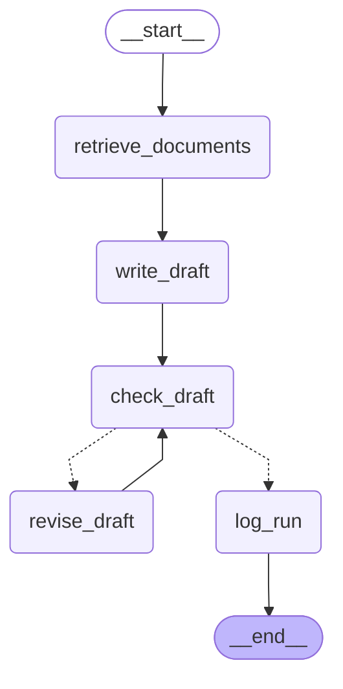
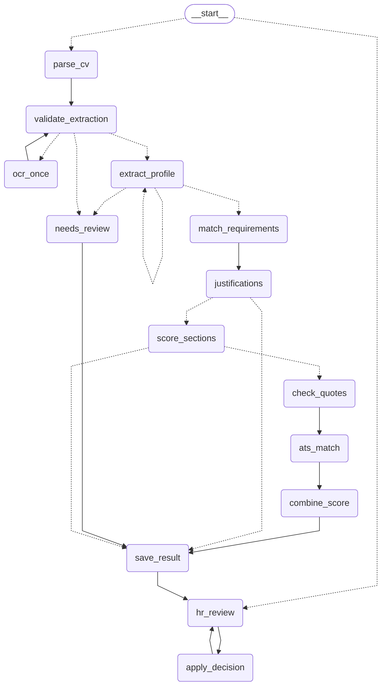
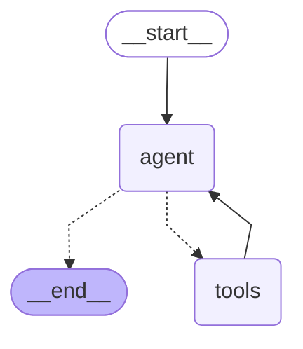

# LumenAI workflows, drawn from the code

Made by `backend/scripts/print_workflows.py`. Do not edit by hand: run the script again after a change.
A solid arrow is always followed. A dotted arrow is a choice made by the code at that step.

## Job description workflow

Code: `backend/app/graphs/job_description_graph.py`

Steps: `retrieve_documents`, `write_draft`, `check_draft`, `revise_draft`, `log_run`

## CV screening workflow (pre-interview subgraph, one run per CV)

Code: `backend/app/graphs/cv_screening_graph.py`

Steps: `parse_cv`, `validate_extraction`, `ocr_once`, `needs_review`, `extract_profile`, `match_requirements`, `justifications`, `score_sections`, `check_quotes`, `ats_match`, `combine_score`, `save_result`, `hr_review`, `apply_decision`

## Assistant agent (the chatbot)

Code: `backend/app/graphs/assistant_agent.py`

Steps: `agent`, `tools`

