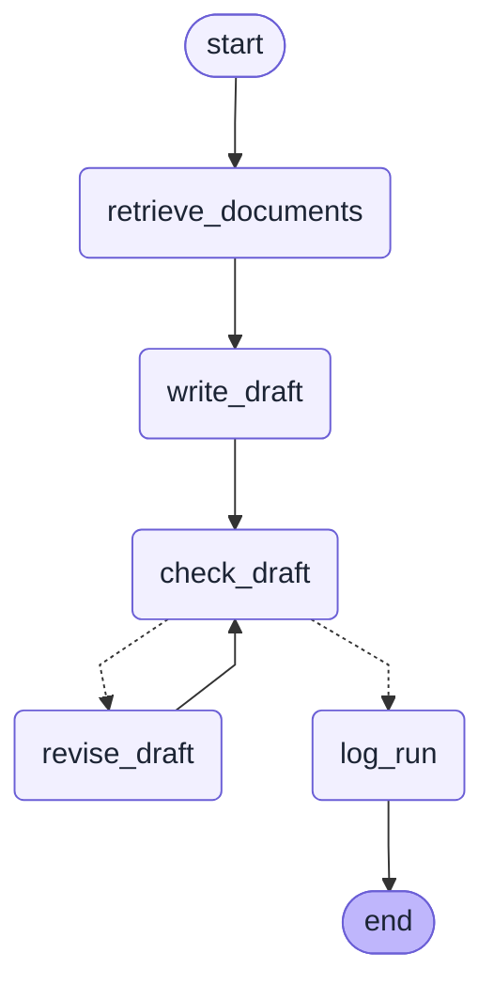
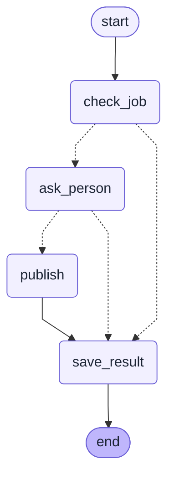
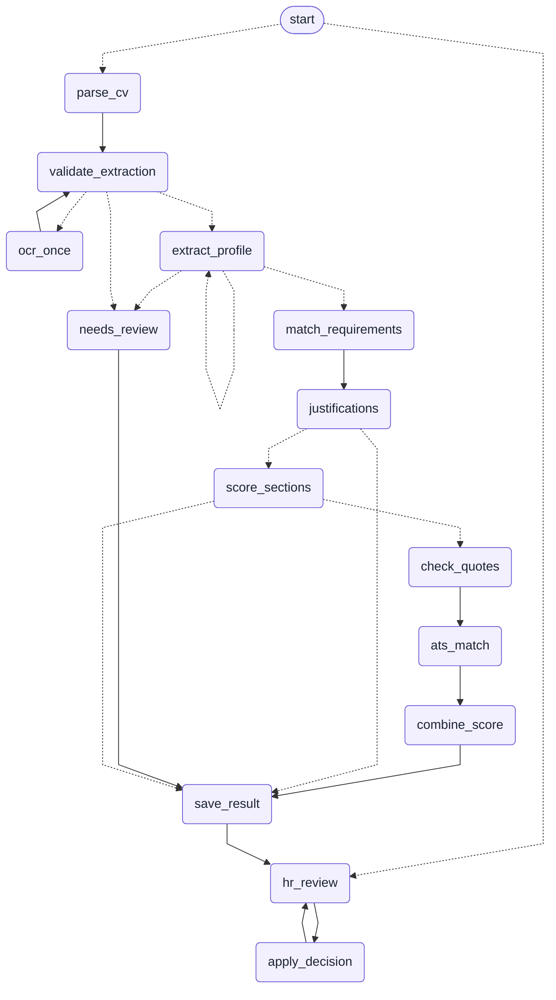
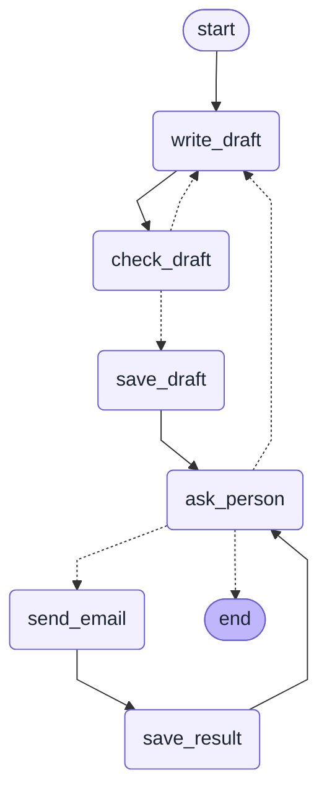
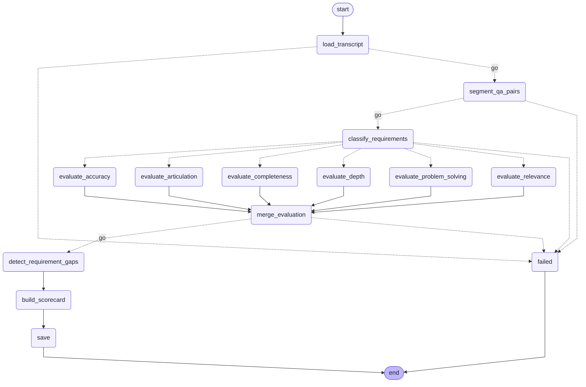
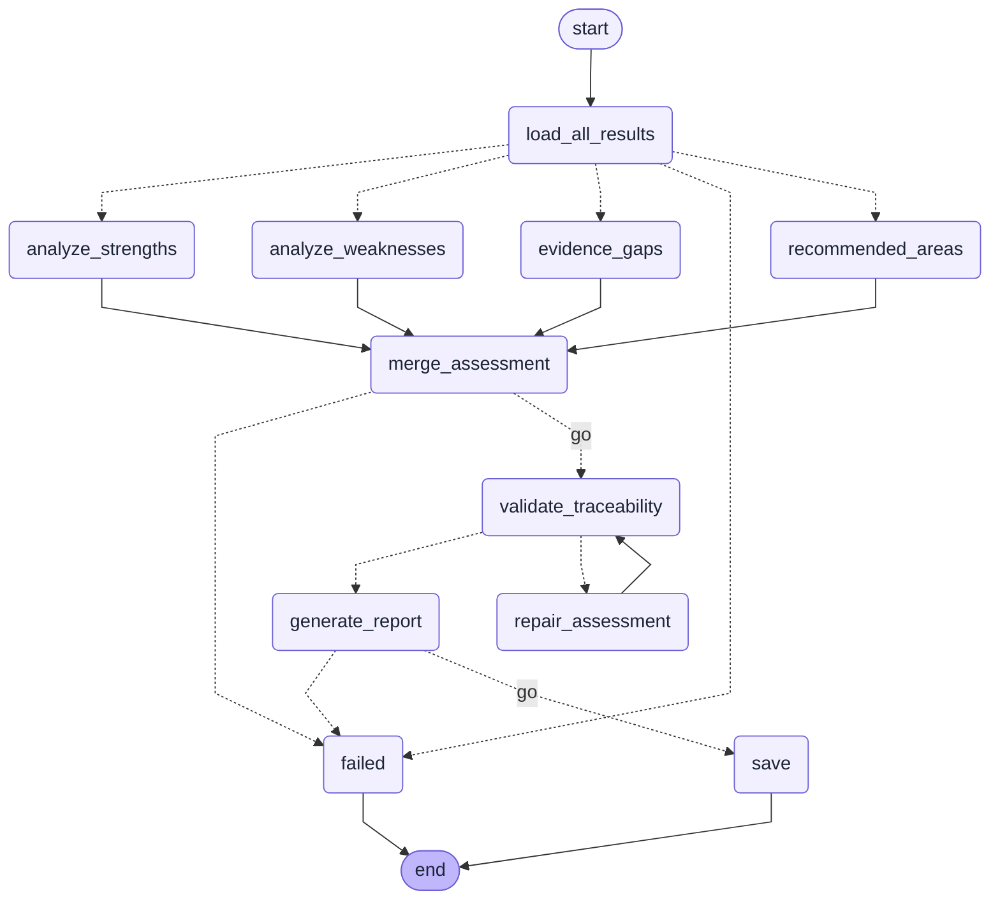
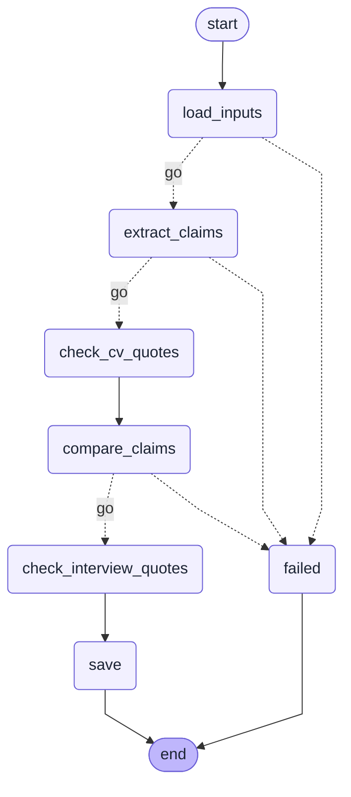
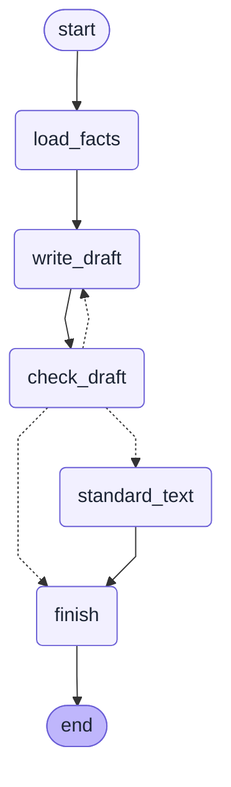
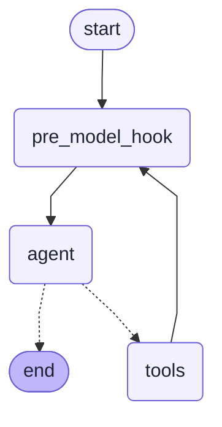

# LumenAI workflows, drawn from the code

Made by `backend/scripts/print_workflows.py`. Do not edit by hand: run the script again after a change.
A solid arrow is always followed. A dotted arrow is a choice made by the code at that step.

## Job description workflow

Code: `backend/app/graphs/job_description_graph.py`

Steps: `retrieve_documents`, `write_draft`, `check_draft`, `revise_draft`, `log_run`

## Job posting workflow (pauses for the interviewer's Yes or No)

Code: `backend/app/graphs/job_post_graph.py`

Steps: `check_job`, `ask_person`, `publish`, `save_result`

## CV screening workflow (pre-interview subgraph, one run per CV)

Code: `backend/app/graphs/cv_screening_graph.py`

Steps: `parse_cv`, `validate_extraction`, `ocr_once`, `needs_review`, `extract_profile`, `match_requirements`, `justifications`, `score_sections`, `check_quotes`, `ats_match`, `combine_score`, `save_result`, `hr_review`, `apply_decision`

## Interview invitation workflow (pauses until the interviewer sends)

Code: `backend/app/graphs/invitation_graph.py`

Steps: `write_draft`, `check_draft`, `save_draft`, `ask_person`, `send_email`, `save_result`

## Q&A analysis workflow (after the interview, one run per interview)

Code: `backend/app/graphs/qa_analysis_graph.py`

Steps: `load_transcript`, `segment_qa_pairs`, `classify_requirements`, `evaluate_relevance`, `evaluate_accuracy`, `evaluate_completeness`, `evaluate_articulation`, `evaluate_problem_solving`, `evaluate_depth`, `merge_evaluation`, `detect_requirement_gaps`, `build_scorecard`, `save`, `failed`

## Assessment workflow (post-interview, one run per candidate)

Code: `backend/app/graphs/assessment_graph.py`

Steps: `load_all_results`, `analyze_strengths`, `analyze_weaknesses`, `evidence_gaps`, `recommended_areas`, `merge_assessment`, `validate_traceability`, `repair_assessment`, `generate_report`, `save`, `failed`

## CV claim verification workflow (after the interview, one run per candidate)

Code: `backend/app/graphs/claim_check_graph.py`

Steps: `load_inputs`, `extract_claims`, `check_cv_quotes`, `compare_claims`, `check_interview_quotes`, `save`, `failed`

## Talent pool invitation workflow (one run per person; a person sends)

Code: `backend/app/graphs/talent_invite_graph.py`

Steps: `load_facts`, `write_draft`, `check_draft`, `standard_text`, `finish`

## Assistant agent (the chatbot)

Code: `backend/app/graphs/assistant_agent.py`

Steps: `agent`, `tools`, `pre_model_hook`

